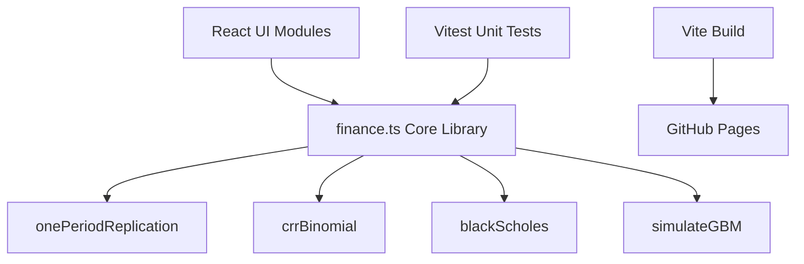

# ReplicateX — The Mathematics of No-Arbitrage

An interactive quantitative finance laboratory that demonstrates how financial derivatives are priced and hedged through **replication**.

> Identical future cash flows must have identical current prices in an arbitrage-free market.

**Author:** [Prakhar Gupta](https://prakharquant.github.io/) · [Email](mailto:bestofprakhar@gmail.com) · [X / Twitter](https://x.com/PrakharQuant) · [LinkedIn](https://www.linkedin.com/in/prakhar-gupta-5b7250372)

## Motivation

Most educational materials either explain derivatives in words or jump straight to the Black–Scholes formula. ReplicateX lets you **construct** the replicating portfolio yourself, see the price emerge from no-arbitrage, detect arbitrage when prices disagree, watch a multi-period tree converge, and experience the residual error of discrete delta hedging.

It is designed for:
- Undergraduate finance students
- People exploring quantitative finance
- Derivatives traders and analysts who want a clean, browser-based sandbox

All calculations run in the browser. No backend, no API keys, no external data.

## Technology Stack

- **React 18** + **TypeScript**
- **Vite** (fast dev server and GitHub Pages–compatible build)
- **Recharts** for interactive charts
- **Tailwind CSS** for a dark financial-terminal aesthetic
- **Vitest** for unit tests of the pricing engine
- Pure TypeScript math library (no numerical libraries required)

## Mathematical Core

The project implements:

1. **One-period binomial replication**  
   Δ = (C_u - C_d) / (S_u - S_d)  
   B = (C_d - Δ S_d) / (1+r)  
   C_0 = Δ S_0 + B

2. **Cox–Ross–Rubinstein multi-period tree** (European & American)  
   u = exp(σ √Δt), d = 1/u, R = exp(r Δt), q = (R - d)/(u - d)  
   Backward induction with early-exercise comparison for American options.

3. **Black–Scholes European formula** and Greeks (call and put, non-dividend).

4. **Dynamic delta-hedging simulation** on a geometric Brownian motion path with discrete rebalancing.

5. **Put-call parity** validation and no-arbitrage checks.

## Modules

| Module | Description |
|--------|-------------|
| **Replication Lab** | Interactive one-period binomial model with live replicating portfolio and payoff chart. |
| **Arbitrage Detector** | Enter a market price; see the locked-in arbitrage profit and zero net exposure at maturity. |
| **Binomial Model** | Full CRR tree, risk-neutral probability, American exercise, no-arbitrage condition. |
| **Dynamic Hedging** | Simulated stock path, evolving delta, shares held, cash account, residual hedging error. |
| **Black–Scholes** | Closed-form prices + Greeks + convergence plot of binomial prices vs. Black–Scholes. |
| **Greeks & Risk** | Interactive visualisations of price, delta, gamma vs. spot and volatility. |
| **Mathematical Foundations** | Structured explanations of Law of One Price, risk-neutral valuation, completeness, limitations. |

## Architecture



## Installation & Local Development

```bash
git clone https://github.com/PrakharQuant/ReplicateX.git
cd ReplicateX
npm install
npm run dev
```

Open http://localhost:5173

## Running Tests

```bash
npm test
```

Tests cover:
- One-period replication numbers (classic 100/120/80 example)
- CRR backward induction and American ≥ European
- Black–Scholes known values and put-call parity
- Normal CDF accuracy

## Deployment to GitHub Pages

The repository includes a GitHub Actions workflow (`.github/workflows/deploy.yml`) that:

1. Runs tests
2. Builds the Vite app with `base: '/ReplicateX/'`
3. Deploys the `dist` folder to GitHub Pages

After the first push to `main`, enable Pages in the repository settings (Source: GitHub Actions). The site will be available at:

**https://prakharquant.github.io/ReplicateX/**

## Assumptions & Limitations

- Frictionless markets (no transaction costs, unlimited borrowing/short selling)
- Continuous rebalancing is only approximated by discrete steps
- Constant volatility, constant rates, no dividends
- Complete markets (one source of randomness)
- Model risk is not priced
- Real-world arbitrage is constrained by liquidity, funding, and execution risk

These limitations are discussed in the Mathematical Foundations section of the app.

## Future Extensions

- Local volatility and stochastic volatility models
- Barrier and Asian options
- Interest-rate derivatives (Black, Hull–White)
- Monte-Carlo pricing with control variates
- Real-time market data via user-supplied CSV
- More advanced American early-exercise algorithms

## License

MIT

---

**Definition of success:** A visitor can open the site, change the financial assumptions, construct a replicating portfolio, watch the derivative price emerge mathematically, simulate dynamic hedging, and understand *why* no-arbitrage pricing works — without reading the source code.
